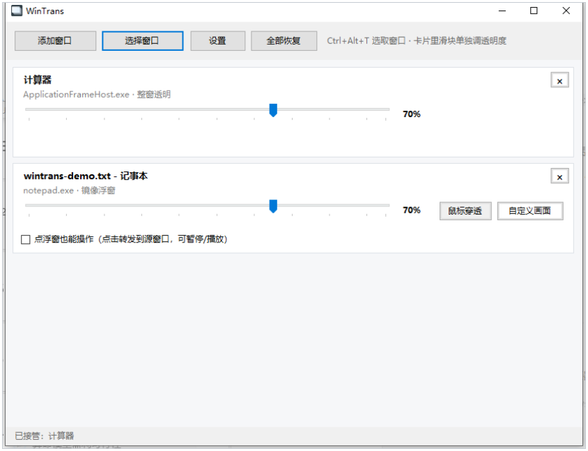
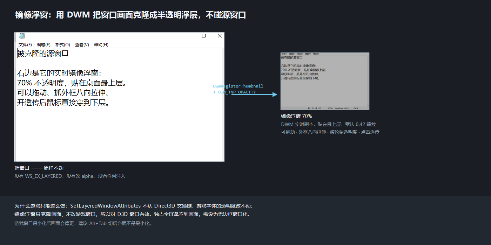

# WinTrans

**非注入式 Windows 窗口透明度工具** —— 不碰别人的进程，把任意窗口、甚至游戏画面调成半透明。




---

## 这是什么

WinTrans 是一个 Windows 上的小工具，用来**调低某个窗口的不透明度**：把浏览器、播放器、聊天窗口调成半透明，压在后面的内容就能透出来。

它有两个模式：

- **整窗透明** —— 直接改窗口属性，适合浏览器、Electron 应用、普通 Win32 窗口。
- **镜像浮窗** —— 用 DWM 把窗口画面实时克隆成一个半透明浮窗贴在最上层，适合**游戏**，以及那些会自己重置窗口样式的程序。

全程 **不向任何进程注入代码**，不装驱动、不挂全局 Hook。改的只是窗口自己的样式位（`WS_EX_LAYERED` / alpha），关掉程序会自动还原。

**典型用法**：一边玩游戏一边看攻略/直播；照着视频临摹写字；把聊天窗口淡下去专注干活；把参考图压在半透明层上比对。

## 和现成工具的区别

| 工具 | 调透明度 | 镜像浮窗 / 自定义画面克隆 | 注入进程 | 授权 |
|---|---|---|---|---|
| **WinTrans** | 有，每窗口独立滑块 | 有，可框选局部区域 | 无 | GPL-3.0 |
| AltSnap / AltDrag | 有，Alt+滚轮 | 无 | 无（AltSnap 已移除注入） | GPL |
| SmartSystemMenu | 有，右键菜单档位 | 无 | **有**，Hook DLL 注入所有进程 | MIT |
| WindowTop | 有 | 有，但闭源 | 无 | 商业付费 |

关键差别在那两个**没有任何开源项目覆盖**的点：`DwmRegisterThumbnail` + `DWM_TNP_OPACITY` 的镜像浮窗，以及 `DWM_TNP_RECTSOURCE` 的自定义画面克隆。整窗透明那一半，AltSnap 已经做得很好了，可以两个一起装。

## 为什么游戏不能直接改透明度

`SetLayeredWindowAttributes` 不认 Direct3D 交换链——D3D11 的 flip 交换模式、D3D12 窗口（只支持 flip）都会失效，设了 alpha 画面也不变。

所以游戏走镜像浮窗：不是让游戏本体变透明，而是把游戏画面实时"复制"成半透明浮窗贴在最上层，操作仍然落在游戏里（配合"鼠标穿透"，鼠标直接穿到游戏窗口）。



上图左边是源窗口（一个记事本，完全没被改动），右边是它的镜像浮窗：DWM 把画面实时克隆过来，按 70% 不透明度贴在最上层。这就是对待 D3D 窗口时唯一有效的做法。

## 两种模式

| 模式 | 原理 | 适用 | 效果 |
|---|---|---|---|
| 整窗透明 | `WS_EX_LAYERED` + `SetLayeredWindowAttributes` | 浏览器、Electron 应用、普通 Win32 窗口 | 整个窗口本体变半透明，直接看到后面内容 |
| 镜像浮窗 | `DwmRegisterThumbnail` + `DWM_TNP_OPACITY` | 游戏（Direct3D 交换链）、样式被重置的窗口 | 生成一个半透明的实时画面副本浮在最上层 |

## 功能

1. **预设档 + 平滑过渡**：25/40/60/75/100 五档，热键一键切换，220ms 线性渐变（16ms 帧），不阻塞界面。
2. **接管前确认弹窗**：选窗口后先弹出确认框，显示标题 / 进程名 / 窗口类 / 句柄，可选择「整窗透明」或「镜像浮窗」、设定初始不透明度，还能勾「排除此软件」——以后不再接管它的任何窗口（防误抓 IDE、录制、输入法面板这类特殊窗口）。
3. **窗口样式自愈**：每 150ms 巡检，补回被目标程序重置掉的 `WS_EX_LAYERED` 位，并读回 alpha 校验——程序把自己的透明度改回不透明也会立刻夺回；句柄被换掉时按「同进程 + 同窗口类 + 同标题」自动重绑。
4. **每窗口独立滑块**：卡片式列表，一张卡片管一个窗口——标题、进程/模式副标题、独立滑块、百分比、鼠标穿透开关、自定义画面按钮、关闭 ×。点卡片即把该窗口设为热键作用对象。
5. **热键全可配**：设置里十项热键，点进输入框直接按组合键即录制（强制至少一个修饰键），保存写 `WinTrans.ini` 并立即重注册；冲突会在状态栏列出被占用的组合。
6. **自定义画面克隆**：镜像模式下可框选源窗口的任意一块区域来克隆（`DWM_TNP_RECTSOURCE` + 仅客户区），浮窗尺寸按区域等比缩放。
7. **镜像浮窗外轮廓拉伸**：抓住浮窗任意一条边或角（7px 内）八向改尺寸，画面实时跟随，最小 80×60；手动拉伸后按新尺寸锁定，心跳不再弹回默认比例。
8. **列表选窗**：主界面「选择窗口」按钮弹出列表，列出当前桌面所有可见窗口（标题 / 进程 / 窗口类 / 句柄，按进程名排序），选中后确定即可接管。准星点不到时用它——被全屏覆盖层挡住、窗口只有一条边露出来、双屏位置记不清，都不影响。

## 使用前须知（免责声明）

启动时软件会弹一次确认框，内容是：

> WinTrans 不注入、不读内存、不模拟输入，但会创建额外窗口/画面副本或修改显示效果，可能被反作弊系统判定为异常，导致警告或封号。
>
> 不建议用于任何启用反作弊的在线游戏或竞技游戏。继续使用即表示你自行承担全部风险。

命令行模式（`--alpha` / `--restore` / `--clone`）不弹这个框；脚本里可以加 `--no-hint` 跳过。

## 下载

| 文件 | 说明 |
|---|---|
| [WinTrans.exe](https://github.com/FOKBLACK/WinTrans/releases/download/v2.10/WinTrans.exe) | 单文件 232 KB，下载双击即用，不需要解压 |
| [WinTrans-2.10-portable-x64.zip](https://github.com/FOKBLACK/WinTrans/releases/download/v2.10/WinTrans-2.10-portable-x64.zip) | 便携包：exe + README + QUICKSTART + LICENSE + ini |

运行要求：Windows 10 / 11 x64，系统自带 .NET Framework 4.8（Windows 10 1511 之后默认就有）。**无需安装、无需管理员权限**；要操作以管理员权限运行的窗口（如任务管理器）时才需要右键以管理员身份启动。

> **关于 SmartScreen**：这个 exe 没有做代码签名（签名证书要花钱），第一次运行时 Windows 可能弹出“Windows 已保护你的电脑 / 未知发布者”。点「更多信息」→「仍要运行」即可。
> 不放心可以不下载二进制：源码就在 `src/WinTrans.cs`，仓库里只有源码和图标，用文末那条 `csc` 命令自己编一个。

> 仓库里不放二进制（`.gitignore` 排除了 `*.exe` / `*.zip` / `dist/`），成品统一在 [Releases](https://github.com/FOKBLACK/WinTrans/releases)。

## 快速上手

双击 `WinTrans.exe`，主界面 + 托盘常驻。

1. 点 **添加窗口**（或热键），屏幕变暗出现准星，点一下目标窗口；点不准就用旁边的 **选择窗口**，从列表里挑。
2. 确认弹窗里选模式、定初始不透明度 → **接管**。
3. 卡片出现后，拖该卡片自己的滑块即可单独调这个窗口（5%–100%）。
4. 游戏/录屏类窗口选 **镜像浮窗**：会出现半透明克隆窗，可拖动、滚轮调透明度、右键菜单切换"鼠标穿透"；卡片上的 **自定义画面** 按钮可再框选要克隆的局部。

### 默认热键（全部可在「设置」里改）

| 热键 | 作用 |
|---|---|
| `Ctrl+Alt+T` | 选取窗口 |
| `Ctrl+Alt+1` ~ `5` | 预设 25% / 40% / 60% / 75% / 100% |
| `Ctrl+Alt+↑` / `↓` | 当前窗口 +5% / -5% |
| `Ctrl+Alt+R` | 全部恢复原样 |
| `Ctrl+Alt+C` | 切换镜像浮窗的鼠标穿透 |

热键作用于「最近一次点选的卡片」；没有则回退到前台窗口对应的卡片。

### 镜像浮窗操作

- 左键拖动移动位置（内部区域，8ms 合并 + 直连 SetWindowPos，不再逐帧走 WinForms 布局）
- **左键抓住外轮廓 7px 范围内的任意一条边或角，可自由拉伸缩放尺寸**，八个方向都支持；光标会变成对应的双向箭头
- 拉伸过程中镜像画面实时跟随；松手后按当前尺寸锁定，不再被心跳改成默认比例
- 想回到"按源窗口比例自动贴合"：右键菜单选「贴合源窗口比例」，或做一次放大/缩小
- 滚轮调透明度（浮窗上前滚变不透明、后滚变透明）
- 卡片滑块拖动时透明度即时跟手，没有渐变延迟
- 右键：鼠标穿透 / 更透明 / 更不透明 / 恢复 100% / 放大 10% / 缩小 10% / 贴合源窗口比例 / 关闭
- 开启"鼠标穿透"后鼠标直接穿到下层窗口，浮窗只负责显示（此时不能拖动和拉伸）
- 最小尺寸 80×60，拉过头会夹住

### 游戏前提

- 游戏必须设为 **无边框窗口化 / 窗口化**，独占全屏拿不到画面（DWM 不合成独占全屏）
- 带反作弊的网游可能拦截第三方浮层，属于预期行为
- 游戏窗口最小化后画面会停更，建议用 Alt+Tab 切到后台而不是最小化

## 配置文件

`WinTrans.ini` 与 exe 同目录，首次运行/保存设置时生成（仓库里给的是 `WinTrans.ini.example`）：

```ini
[General]
Exclude=taskmgr.exe

[Hotkeys]
Pick=3,84        ; 修饰键位掩码, 虚拟键码（3 = Ctrl|Alt；84 = T）
Preset1=3,49     ; 1
Preset2=3,50     ; 2
Preset3=3,51     ; 3
Preset4=3,52     ; 4
Preset5=3,53     ; 5
Up=3,38          ; ↑
Down=3,40        ; ↓
Restore=3,82     ; R
Through=3,67     ; C
```

`Exclude` 用分号分隔多个进程名（大小写不敏感）。

## 命令行（可脚本化）

```bat
WinTrans.exe --alpha 60 --hwnd 0x00120A34                          直接给某个窗口设 60% 透明
WinTrans.exe --restore --hwnd 0x00120A34                          还原该窗口
WinTrans.exe --clone --hwnd 0x00120A34 --alpha 80 --scale 0.3     开镜像浮窗（不弹主界面）
WinTrans.exe --clone --hwnd 0x00120A34 --region 100,80,420,220    只克隆客户区 (100,80) 起 420×220 那块
```

适合写批处理给固定游戏开浮窗。

## 还原机制

- 接管前记录原始 `WS_EX_LAYERED` 状态与 color/alpha/flags；移除卡片、关闭程序、"全部恢复"都精确还原
- 关闭镜像浮窗会 `DwmUnregisterThumbnail`，不留残留
- 程序退出时会遍历所有已接管窗口做还原（不会把别人的窗口留在半透明状态）

## 已知限制

- 管理员权限运行的窗口（如任务管理器）无法被普通权限的 WinTrans 修改，需右键以管理员身份运行
- 少数程序会自己重置窗口样式：自愈会在 150 毫秒内把分层位和 alpha 一起补回（安卓应用 / 模拟器这类会被短暂“实闪”一下，介意就用镜像浮窗）
- 不支持 UWP 应用窗口的直接透明（走镜像模式可以）
- 与 AltSnap 同时常驻时注意热键别撞车（AltSnap 占 Alt+滚轮/Alt+拖动）
- 拾取会主动跳过**全屏透明覆盖层**（NVIDIA GeForce Overlay、Discord / Steam 游戏内覆盖之类）：它们置顶铺满屏幕，不跳过的话每次都会选中它们而不是你想要的软件。想调这类覆盖层本身，用命令行 `--alpha` 指定句柄

## 版本变更

### 2.10（本地构建，尚未发布）

- **新增卡片开关「点浮窗也能操作（点击转发到源窗口，可暂停/播放）」**：勾选后在浮窗画面上单击，会按浮窗与源窗口的缩放比例把坐标换算回源窗口客户区，再投递鼠标消息过去，于是可以在浮窗上暂停/播放。默认关闭；拖动、滚轮调透明度、外轮廓拉伸都不受影响。鼠标穿透打开时该选项自动置灰。
- **修「右键菜单里切换鼠标穿透，主界面卡片不同步」**：浮窗切换鼠标穿透后会回调主界面刷新卡片状态与状态栏；右键菜单每次打开都按当前实际状态刷新勾选，不再出现菜单显示与实际不符。
- 命令行 `--clone` 新增 `--forward` 参数，可直接以「点击转发」模式启动浮窗。
- 卡片布局调整：卡片高度加高，「点浮窗也能操作」独占一行，不再被滑块遮挡；右侧按钮改为从卡片右边缘往左排布，按钮文字变长也不会被挤出卡片。
- 修「自定义画面（原区域）框选后浮窗塌成一个小方块」：旧逻辑用浮窗原有的缩放比乘以新框选的区域尺寸，框一小块时会被最小值（80×60）兜住，看起来像没生效。现在换算法——按新区域重新换算缩放比，浮窗保持当前显示尺寸并把框选的那块填满，画面立刻正确。
- 框选没反应时给提示：范围小于 24×24，或框到了源窗口客户区之外，状态栏会说明原因，不再静默关闭。
- 界面用词统一：「透传」改为「鼠标穿透」，「区域」改为「自定义画面」（涉及卡片按钮、浮窗右键菜单、设置里的热键名、状态栏提示、框选提示）。

### 2.9

- **启动免责声明**：GUI 启动时弹出使用前须知，说明「不注入、不读内存、不模拟输入，但会创建额外窗口/画面副本或修改显示效果，可能被反作弊系统判定为异常」以及不建议用于启用反作弊的在线游戏。命令行模式（`--alpha` / `--restore` / `--clone`）跳过，也可用 `--no-hint` 强制跳过。
- 功能与 2.8 一致，只加这一处提示。

### 2.8

- **自愈提速到 150 毫秒，并同时校验 alpha**：原来 900 毫秒才检查一次、且只补 `WS_EX_LAYERED` 位；现在既补位，也用 `GetLayeredWindowAttributes` 读回实际值，被程序改成不透明也立刻夺回。实测外部抹掉分层位后 **147 毫秒**恢复。
- **窗口重建自动重绑**：程序换句柄后（安卓运行时、Qt 应用、切播放器时会换），卡片按「同进程 + 同窗口类 + 同标题」自动接上新窗口并重设透明度，不再变成一张失效卡片。
- **接管前风险提示**：命中安卓运行时 / 模拟器（`Androws`、`dnplayer`、`MuMuPlayer`、`HD-Player` 等）或含 `subWin` 子窗的 Qt 窗口时，确认弹窗显示橙色提示——「该窗口可能不支持稳定透明（点击后会实闪约 1 秒）」。默认仍选「整窗透明」，不替你改选项。
- 成因实测：这类窗口在交互时会自己把窗口样式写回不带分层位的原值，于是瞬间变实心，等自愈补回才恢复——所以现象是「点击后实闪约 1 秒」，不是透明度丢了。

### 2.7

- **许可证由 MIT 改为 GPL-3.0-or-later**：`LICENSE` 换成 GNU GPL v3 官方全文；源码文件头加入版权与许可声明；README 许可证一节重写。目的是让任何基于本项目的衍生版本也必须保持开源。
- 此前按 MIT 发布的 v2.1–v2.6 不受影响，已授出的许可不可撤销；本次变更只适用于之后的版本。
- 功能与 2.6 完全一致（仅注释与文档变化）。

### 2.6

- **新增「选择窗口」按钮**：主界面按钮旁弹出列表，列出当前所有可见顶层窗口（标题 / 进程 / 窗口类 / 句柄），按进程名排序，单选后点「确定」或双击、回车即可进入原有的接管确认流程。列表已滤掉托盘、输入法面板和全屏覆盖层，不会出现点了没反应的空壳条目。
- 解决的是「准星点不到」这类问题：窗口被 NVIDIA / Steam 覆盖层压着、窗口只露一条边、多屏位置记不清、远程桌面下手感差。

### 2.5

- **修「选了窗口总是选中 NVIDIA GeForce Overlay」**：拾取时按 Z 序取最上层窗口，而 NVIDIA 覆盖层（`CEF-OSC-WIDGET`，`WS_EX_TRANSPARENT`，置顶 1919×1080 全屏）永远盖在最上面，于是每次点哪都命中它。现在拾取会跳过 `WS_EX_TRANSPARENT` 的点击穿透窗口、`CEF-OSC-WIDGET` 类，以及 `NVIDIA Overlay.exe` / `NVIDIA Share.exe` 的窗口，命中的是你真正指的那一层。
- 同一处顺手跳过 Discord / Steam 之类的游戏内覆盖层。

### 2.4

- **托盘图标重做**：原图的白色叠窗占比太大，落到 16px 托盘尺寸时糊成一个白块。现在 16 / 20 / 24 三个小尺寸改用单独绘制的简化版（深色圆角底 + 白色窗框线），32 及以上仍用原始美术，两种尺寸下都能认出是"一个窗口"。
- README 增加镜像浮窗实拍说明图、SmartScreen 提示与对比表。

### 2.3

- 修复**托盘右键「退出」点了没反应**：`ExitApp()` 原本直接调 `Close()`，而 `OnFormClosing` 把「用户关闭」一律 `e.Cancel = true` 后 `Hide()`，于是点退出只是又隐藏了一次，进程留在托盘里。
- 改为增加 `exiting` 意图标志：托盘退出先置标志、再 `Close()`，`OnFormClosing` 只对「非退出意图的用户关闭」做拦截；退出时先 `tray.Visible = false` 摘掉图标，再恢复全部窗口透明度、注销热键（各自 try/catch 兜底，保证不会被异常卡住退出）。
- 点窗口右上角 × 的行为不变：仍然最小化到托盘，热键继续可用。

### 2.2

- 卡片滑块拖动时**即时生效**，不再每次 Scroll 都重启动 220ms 渐变（原来拖动中透明度几乎不动、松手才补动画，看起来就是跳）
- 拖动中不把数值写回 TrackBar，避免滑块被程序回写打断；百分比数字按 ~33fps 刷新，松手/松键立刻校准
- 预设热键（Ctrl+Alt+1~5）仍然保留 220ms 平滑过渡，不受影响

### 2.1

- 镜像浮窗支持**外轮廓拉伸缩放**：抓住任意一条边或一个角（7px 内）即可八向改尺寸，画面实时跟随，最小 80×60
- 浮窗拖动改为直连 `SetWindowPos` + 8ms 合并，不再每帧走 WinForms 布局与重绘，拖动跟手度提升
- 手动拉伸后自动按新尺寸锁定（`FitLocked=false`），心跳不再把尺寸弹回默认比例；右键「贴合源窗口比例」可恢复
- 主窗标题精简为 `WinTrans`，程序图标换成自定义多尺寸 `.ico`

## 编译

```bat
csc /target:winexe /platform:x64 /optimize+ /out:WinTrans.exe /win32icon:ICON.ico ^
    /r:System.dll /r:System.Drawing.dll /r:System.Windows.Forms.dll src\WinTrans.cs
```

编译器用系统自带的 `C:\Windows\Microsoft.NET\Framework64\v4.0.30319\csc.exe`（C# 5 语法），无需安装 SDK。编译前先结束正在运行的 `WinTrans.exe`，否则 exe 被占用会报 CS0016。

## 图标

- `ICON.ico` 含 16/20/24/32/40/48/64/96/128/256 十个尺寸帧，全部由 `ICON.png` 派生
- **16 / 20 / 24 是小尺寸专用版**：原图那种"深底 + 三层半透明白窗"在高分辨率下很好看，但压到 16px 时白色块会糊成一团，所以这三个尺寸单独绘制成"深色圆角底 + 白色窗框线 + 标题栏分隔线"，在深色任务栏和浅色资源管理器里都认得出来
- 32 及以上沿用原始美术（≥128 用 PNG 帧压缩，其余为 32bpp DIB + AND 掩码）
- 主窗标题栏、任务栏、Alt-Tab 用 32 帧，托盘用 16 帧
- 想换成自己的图标：替换 `ICON.ico` 后按上面的命令重编译即可，文件名固定

## 许可证

[GPL-3.0-or-later](LICENSE) — GNU 通用公共许可证第 3 版（2007-06-29）或其后的任何版本。

- **可以**：自由使用、修改、再分发，商业环境里用也可以（包括公司内部部署）
- **必须**：再分发（无论是原版还是你改过的版本）时，一并提供完整对应源码，并继续以 GPLv3 授权；保留版权声明与许可证文本
- **不可以**：把衍生版本改成闭源再发布，或附加“禁止商用”之类的额外限制

版权归 `FOKBLACK` 所有，作者不承担使用后果。此前按 MIT 发布的 v2.1–v2.6 仍按 MIT 有效——已授出的许可是不可撤销的，本次变更只适用于之后的版本。
